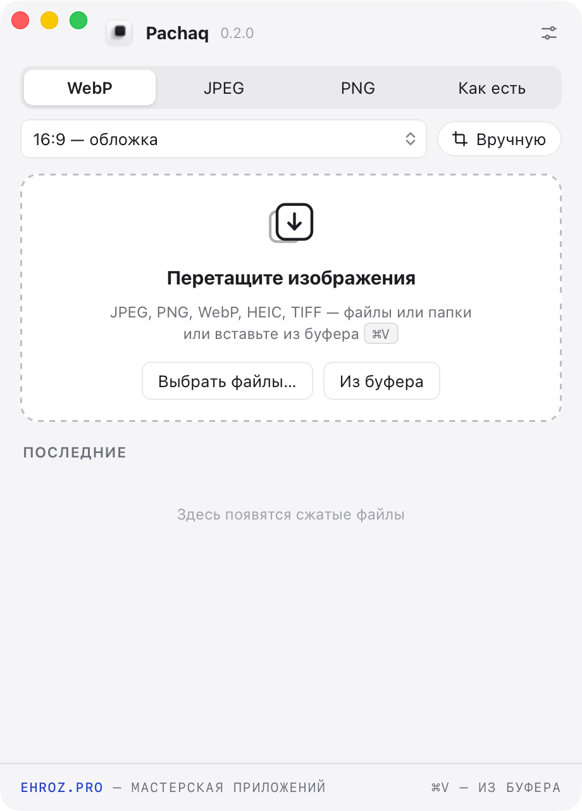
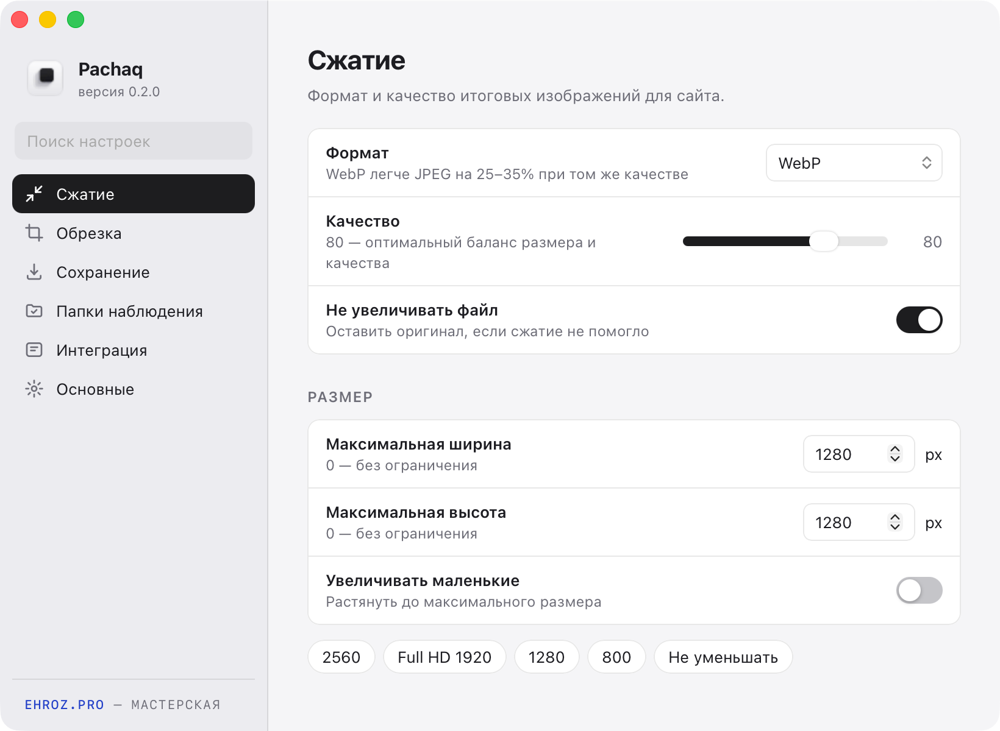

<h1 align="center">Pachaq</h1>

Сжатие и обрезка фотографий для сайта — для macOS и Windows. Перетащили фото — получили лёгкий файл нужного формата.

  <a href="https://github.com/ehroz1/pachaq-releases/releases/latest/download/Pachaq-Setup.exe"><b>⬇︎ Windows</b></a>
  &nbsp;·&nbsp;
  <a href="https://github.com/ehroz1/pachaq-releases/releases/latest/download/Pachaq-arm64.dmg"><b>⬇︎ macOS (Apple Silicon)</b></a>
  &nbsp;·&nbsp;
  <a href="https://github.com/ehroz1/pachaq-releases/releases/latest/download/Pachaq-intel.dmg"><b>⬇︎ macOS (Intel)</b></a>

<a href="https://github.com/ehroz1/pachaq-releases/releases/latest">Все файлы последней версии</a> · <a href="https://ehroz.pro">ehroz.pro</a>

&nbsp;&nbsp;

## Что умеет

- **Сжатие для веба** — WebP, JPEG (MozJPEG), PNG (oxipng). Обычно −70…95% к размеру без видимой потери качества.
- **HEIC с iPhone**, TIFF, BMP, GIF на входе — на выходе формат, который открывается везде.
- **Размер** — уменьшение до нужной ширины или высоты (Full HD, 1280, 800 или своё).
- **Обрезка под формат** — 1:1, 4:3, 3:2, 16:9, 4:5, 9:16, 21:9 или своё соотношение. Кадр выбирается автоматически («умная» обрезка находит лица и детали) или **вручную рамкой**.
- **Буфер обмена** — <kbd>⌘V</kbd> / <kbd>Ctrl+V</kbd> в окне сжимает скриншот или скопированные файлы.
- **Папки наблюдения** — положили файл в папку, он сразу сжался в подпапку `pachaq/`.
- **Контекстное меню** — «Сжать в Pachaq» по правому клику в Finder и Проводнике.

## Установка

**Windows.** Скачайте `Pachaq-Setup.exe` и запустите. Права администратора не нужны.
Если Windows покажет «Windows защитила ваш компьютер» — «Подробнее» → «Выполнить в любом случае».
Для фото HEIC установите бесплатное расширение «HEIF Image Extensions» из Microsoft Store.

**macOS.** Скачайте `.dmg` для своего Mac (Apple Silicon — M1 и новее, Intel — до 2020 года), откройте и перетащите Pachaq в «Программы».
Первый запуск: правый щелчок по Pachaq → «Открыть» → «Открыть».
Если macOS не пускает: «Системные настройки → Конфиденциальность и безопасность → Всё равно открыть»
или в Терминале `xattr -dr com.apple.quarantine /Applications/Pachaq.app`.

При первом запуске Pachaq проведёт короткое знакомство: формат, размер, обрезка, куда сохранять.

## Обновления

Pachaq обновляется сам: проверяет этот репозиторий при запуске и каждые 6 часов. Когда выходит новая версия,
появляется окно «Доступно обновление» — один щелчок, и она скачивается, проверяется по подписи и ставится с перезапуском.
Проверить вручную: «Настройки → Основные → Проверить сейчас».

## Настройки не потеряются

Настройки хранятся отдельно от программы, с копией в домашней папке (`~/.pachaq/settings.json`).
Удалили и поставили Pachaq заново — всё вернётся само.

---

Здесь только готовые сборки — исходный код закрыт. <a href="https://ehroz.pro"><b>ehroz.pro</b></a> — мастерская приложений

